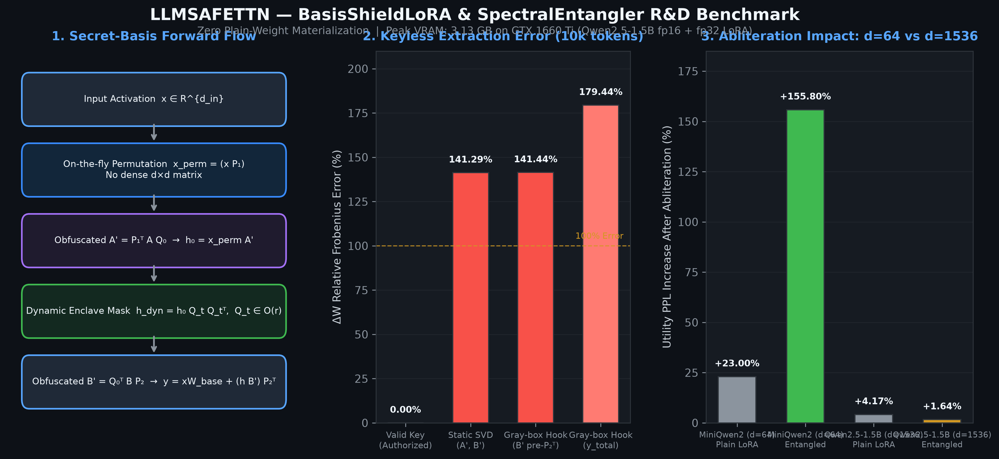

<p align="center">
  
</p>

<h1 align="center">LLMSAFETTN — BasisShieldLoRA &amp; SpectralEntangler</h1>

<p align="center">
  
  
  
  
</p>

An R&amp;D prototype for **on-premise / edge LLM IP protection and alignment hardening**. The project explores a hybrid architecture where the base model remains frozen in `fp16` while proprietary domain knowledge, business logic, and safety boundaries are encapsulated in a protected low-rank adapter (`BasisShieldLoRA`) coupled with spectral entanglement regularization (`SpectralEntanglerLoss`).

<p align="center">
  
</p>

---

## Architecture Overview

### 1. `BasisShieldLoRA` — Computation in a Secret Transformed Basis
Instead of disk encryption that decrypts weights into plaintext inside VRAM before matrix multiplication, `BasisShieldLoRA` executes LoRA projections ($\Delta W = A B$) directly in a secret transformed basis without ever materializing plain $A$ or $B$ in `state_dict()` or memory:

$$y = x W_{\text{base}} + \big((x P_1) \cdot A'\big) \cdot Q_t Q_t^T \cdot \big(B' \cdot P_2^T\big)$$

- **Stored weights:** Only obfuscated factors $A' = P_1^T A Q_0$ and $B' = Q_0^T B P_2$.
- **Zero dense $d \times d$ matrices:** Signed permutations $P_1, P_2$ are applied on the fly to activation vectors via 1D indexing and sign flips.
- **Dynamic low-rank masking:** $Q_0, Q_t \in O(r)$ are derived via HMAC-SHA256 + QR decomposition so intermediate rank-$r$ activations also remain masked per step/token.
- **Mixed-precision safe:** Runs cleanly with a frozen `fp16` base model and `fp32` adapter weights on Turing GPUs (no `bfloat16` required).

### 2. `SpectralEntanglerLoss` — Subspace Coupling Against Abliteration
Penalizes orthogonality between the top-$k$ principal singular vectors of utility representations and safety/refusal representations (computed via differentiable subspace power iteration + modified Gram-Schmidt):

$$\mathcal{L}_{\text{entangle}} = \lambda \cdot \left(1 - \frac{1}{k}\sum_{i=1}^k |\langle u_i^{\text{util}}, u_i^{\text{safe}} \rangle|\right)$$

---

## Benchmark Results (Stages 1–4.1)

### Stage 1: Unit Verification (`BasisShieldLoRA`)
- **Mathematical equivalence (valid key):** `||y_plain - y_shield|| < 1e-5` (`float64`), relative L2 error and `max_abs_err < 1e-5` (`float32`).
- **Wrong-key degradation:** Output collapses to noise (`cos_sim < 0.05`, relative error `> 100%`).
- **Memory & checkpoint hygiene:** Plain `A`, `B`, and permutation/orthogonal key matrices are absent from `state_dict()`, parameters, buffers, and module attributes.

### Stage 2: Weight Extraction Attack (`d_in=256, d_out=256, rank=64, 10,000 tokens`)
| Attack Scenario | $\Delta W$ Rel. Error | Output Rel. Error | CosSim |
| :--- | :---: | :---: | :---: |
| **Static SVD on `(A', B')`** | **141.29%** | **141.58%** | 0.0019 |
| **Gray-box Hook (`B'` before $P_2^T$, 10k tokens)** | **141.44%** | **141.29%** | 0.0003 |
| **Gray-box Hook (`y_total` without base subtraction, 10k tokens)** | **179.44%** | **179.39%** | 0.4868 |
| *Oracle Limit (authorized enclave + isolated `y_lora`, 10k tokens)* | *0.00%* | *0.00%* | *1.0000* |

### Stage 3: Abliteration Resistance on `MiniQwen2LM` (`d_model=64, n_layers=2`)
| Model | Refusal Before | Refusal After | PPL Before | PPL After | PPL Delta |
| :--- | :---: | :---: | :---: | :---: | :---: |
| **(A) Plain LoRA** | 0.9236 | 0.0460 | 1.08 | 1.33 | **+23.00%** |
| **(B) Entangled + `BasisShieldLoRA`** | 0.9218 | 0.0153 | 1.11 | 2.84 | **+155.80%** |

### Stage 4.1: Full-Depth `Qwen2.5-1.5B-Instruct` Validation (`layers.0..27`, `rank=8`, GTX 1660 Ti)
- **Peak CUDA VRAM allocated:** **`3.13 GB`** (`fp16` frozen base + `fp32` LoRA + gradient checkpointing, zero OOM / zero NaN)

| Model / Attack Mode | Refusal Before | Refusal After | PPL Before | PPL After | PPL Delta | Speed (`tok/s`) |
| :--- | :---: | :---: | :---: | :---: | :---: | :---: |
| **(A) PlainLoRA (White-box Abl.)** | 100.00% | 75.00% | 1.02 | 1.06 | +4.17% | **8.4** |
| **(B) BasisShield (Keyless Abl.)** | 87.50% | 12.50% | 1.26 | 1.29 | +1.81% | **4.2** |
| **(B) Entangled (Merged/Auth Abl.)** | 87.50% | 0.00% | 1.26 | 1.29 | +1.64% | **4.2** |

*(In Stage 4 on `layers.20..27`, wrong-key inference also degraded adapted utility PPL from `1.16` to `2.95` and dropped refusal from `100.00%` to `87.50%`.)*

---

## Key Findings & Scientific Limitations

1. **BasisShieldLoRA vs. the Linear Oracle Limit:**
   `BasisShieldLoRA` prevents static weight theft (`141.29%` SVD reconstruction error) and gray-box memory hooking of intermediate states (`141.44%`–`179.44%` error). However, if an attacker already has access to an **authorized, key-holding enclave** *and* can cleanly isolate `y_lora = y_total - y_base` across $N \ge d_{\text{in}}$ linearly independent inputs, a purely linear LoRA $\Delta W$ can still be solved via Ridge Regression (`Oracle Limit: 0.00%`). Production deployments must therefore fuse $P_2^T$ into subsequent non-linearities (`RMSNorm` / `SwiGLU`) or keep `y_base` inseparable inside a trusted kernel.

2. **Negative Scaling Result — Passive `SpectralEntanglerLoss` at `d_model=1536`:**
   While passive `SpectralEntanglerLoss` caused utility perplexity to explode by **`+155.80%`** (vs. `+23.00%` baseline) when ablating the compact `MiniQwen2LM` (`d_model=64`), applying it for 48 steps on `hidden_states[-1]` of `Qwen2.5-1.5B-Instruct` (`d_model=1536`) **did not prevent clean refusal removal** (`Refusal: 87.50% -> 0.00%` with only `+1.64%` PPL change). In high-dimensional pretrained transformers, frozen base-model knowledge spans orthogonal subspaces that bypass a passive final-layer regularizer. Next-generation defense requires **active, TAR-style bi-level tamper-resistance** (simulating differentiable ablation inside the training loop across all layers).

---

## Quickstart

```bash
# 1. Create environment and install dependencies
uv venv .venv
uv pip install --python .venv/bin/python torch pytest transformers safetensors accelerate matplotlib

# 2. Run all unit and security tests
.venv/bin/pytest -v

# 3. Run Stage 2 weight-extraction attack benchmark
.venv/bin/python -m benchmarks.attack_extraction

# 4. Run Stage 3 MiniQwen2LM Abliteration benchmark
.venv/bin/python -m benchmarks.attack_abliteration

# 5. Run Stage 4.1 Qwen2.5-1.5B-Instruct benchmark (requires local HF cache + CUDA GPU)
.venv/bin/python -m benchmarks.real_qwen_demo
```

---

<details>
<summary><strong>Краткое резюме проекта (на русском)</strong></summary>

**LLMSAFETTN** — R&amp;D-прототип гибридной защиты весов и выравнивания локальных LLM:
- **`BasisShieldLoRA`** выполняет вычисления LoRA-адаптера непосредственно в секретном перестановочно-ортогональном базисе без материализации открытых матриц $A, B$ в памяти или `state_dict()`. Статический SVD и gray-box перехват промежуточных активаций дают ошибку восстановления **> 141%**; неверный ключ деградирует адаптированный навык.
- **Боевая проверка на `Qwen2.5-1.5B-Instruct` (GTX 1660 Ti, 6 GB VRAM):** пиковое потребление **3.13 GB VRAM** (`fp16` база + `fp32` адаптер по всем 28 слоям) без OOM и NaN.
- **Честный научный вывод:** пассивный `SpectralEntanglerLoss` эффективно ломает utility при Abliteration на компактной модели (`MiniQwen2LM`, `d_model=64`, PPL **+155.80%** против **+23.00%**), но на предобученной 1.5B-модели (`d_model=1536`) обходится за счёт знаний замороженной базы (`PPL Delta +1.64%`). Следующий шаг R&amp;D — активное TAR-подобное обучение с дифференцируемой симуляцией атаки внутри цикла оптимизации.

</details>
